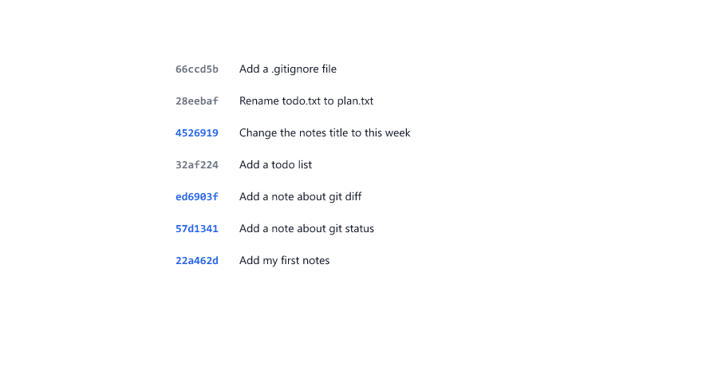

# Looking at History

> **Session 5 of 12** | Part 1: Git on Your Computer | [All sessions](README.md#course-outline)

## Table of Contents
- [Where You Left Off](#where-you-left-off)
- [The Full History: git log](#the-full-history-git-log)
- [One Line per Commit](#one-line-per-commit)
- [HEAD and main](#head-and-main)
- [Look at One Commit: git show](#look-at-one-commit-git-show)
- [See an Old Version of a File](#see-an-old-version-of-a-file)
- [Compare Two Commits](#compare-two-commits)
- [Only Some Commits](#only-some-commits)
- [Who Changed This Line?](#who-changed-this-line)
- [History in VS Code](#history-in-vs-code)
- [Beginner Mistakes](#beginner-mistakes)
- [Practice Exercises](#practice-exercises)
- [Interview Questions](#interview-questions)

---

## Where You Left Off

`my-notes` has seven commits from Sessions 03 and 04. Every command in this session only **reads** the history: none of them changes your files.

```bash
git status
```

```text
On branch main
nothing to commit, working tree clean
```

---

## The Full History: git log

```bash
git log -2
```

```text
commit 66ccd5bb614b6856c1a89bd6bb368f7b88c7d0a3 (HEAD -> main)
Author: Riya Sharma <riya@example.com>
Date:   Tue Nov 3 09:30:00 2026 +0530

    Add a .gitignore file

commit 28eebaf54c40e404cbf99ab3927ab478a6e4f596
Author: Riya Sharma <riya@example.com>
Date:   Tue Nov 3 09:20:00 2026 +0530

    Rename todo.txt to plan.txt
```

`-2` shows only the newest two commits. Without it, `git log` shows every commit, the newest first.


| Line                       | Meaning                                         |
| -------------------------- | ----------------------------------------------- |
| `commit 66ccd5bb...`       | The full commit ID, 40 characters               |
| `(HEAD -> main)`           | The commit you are on now (see below)           |
| `Author:`                  | Who made the commit                             |
| `Date:`                    | When                                            |
| The indented line          | The message                                     |

When the history does not fit on the screen, Git shows it one page at a time, with a `:` at the bottom. Press **Space** for the next page and **q** to quit.


---

## One Line per Commit

```bash
git log --oneline
```

```text
66ccd5b (HEAD -> main) Add a .gitignore file
28eebaf Rename todo.txt to plan.txt
4526919 Change the notes title to this week
32af224 Add a todo list
ed6903f Add a note about git diff
57d1341 Add a note about git status
22a462d Add my first notes
```

Each line has the short ID (the first 7 characters) and the message. Most of the time, this is all you need. To see only the newest few, add a number

```bash
git log --oneline -3
```

```text
66ccd5b (HEAD -> main) Add a .gitignore file
28eebaf Rename todo.txt to plan.txt
4526919 Change the notes title to this week
```

---

## HEAD and main


* `main` is the name of your branch. It points to the newest commit of that branch
* `HEAD` means **where you are now**. `(HEAD -> main)` means you are on `main`, at its newest commit
* `HEAD~1` is one commit before `HEAD`, `HEAD~2` is two commits before, and so on

```bash
git log --oneline -1 HEAD~2
```

```text
4526919 Change the notes title to this week
```

You can use `HEAD`, `HEAD~1` and so on wherever you would use a commit ID. Session 07 explains branches.

---

## Look at One Commit: git show

```bash
git show 4526919
```

```text
commit 452691903ac29091fc42362f0c75a419280a1ca3
Author: Riya Sharma <riya@example.com>
Date:   Tue Nov 3 09:12:00 2026 +0530

    Change the notes title to this week

diff --git a/notes.txt b/notes.txt
index c7fd016..5bcc735 100644
--- a/notes.txt
+++ b/notes.txt
@@ -1,4 +1,4 @@
-Things I learned today
+Things I learned this week
 - Git saves snapshots called commits
 - git status shows what Git sees
 - git diff shows what changed
```

`git show` prints the commit's details and the diff of what it changed. Use the IDs from **your own** `git log`, because the ones in this course do not exist in your repository. `git show` without an ID shows the newest commit.


---

## See an Old Version of a File

Write a commit ID, a colon, and a file name

```bash
git show 22a462d:notes.txt
```

```text
Things I learned today
- Git saves snapshots called commits
```

That is `notes.txt` exactly as it was in the first commit. It is only printed: your folder does not change.


---

## Compare Two Commits

Give `git diff` two commits

```bash
git diff 22a462d HEAD -- notes.txt
```

```text
diff --git a/notes.txt b/notes.txt
index 8343f3f..5bcc735 100644
--- a/notes.txt
+++ b/notes.txt
@@ -1,2 +1,4 @@
-Things I learned today
+Things I learned this week
 - Git saves snapshots called commits
+- git status shows what Git sees
+- git diff shows what changed
```

This is everything that changed in `notes.txt` between the first commit and now. `-- notes.txt` limits the output to one file; leave it out to compare all files. Read it the same way as in Session 04: `-` is the old line, `+` is the new one.

---

## Only Some Commits

The commits that changed one file

```bash
git log --oneline notes.txt
```

```text
4526919 Change the notes title to this week
ed6903f Add a note about git diff
57d1341 Add a note about git status
22a462d Add my first notes
```

The commits whose message contains a word

```bash
git log --oneline --grep "todo"
```

```text
28eebaf Rename todo.txt to plan.txt
32af224 Add a todo list
```



Searching by message only works when messages say what the commit does (Session 04).

---

## Who Changed This Line?

```bash
git blame notes.txt
```

```text
45269190 (Riya Sharma 2026-11-03 09:12:00 +0530 1) Things I learned this week
^22a462d (Riya Sharma 2026-11-02 10:00:00 +0530 2) - Git saves snapshots called commits
57d13410 (Riya Sharma 2026-11-02 10:20:00 +0530 3) - git status shows what Git sees
ed6903f7 (Riya Sharma 2026-11-03 09:00:00 +0530 4) - git diff shows what changed
```


For every line, you see the commit that last changed it, who made that commit, and when. In a team, this tells you who to ask about a line. Despite the name, it is not about blaming anyone.

---

## History in VS Code

VS Code can show the same history without commands

* **Timeline**: click a file in the Explorer, and the **TIMELINE** panel at the bottom of the Explorer lists the commits that changed it. Click one to see its changes
* **Source Control** (**Ctrl+Shift+G**): shows your current changes and a graph of your commits

This course uses the terminal, because the commands work the same everywhere.

---

## Beginner Mistakes

### Mistake 1: Getting stuck in git log

There is a `:` at the bottom of the terminal, and typing does nothing useful. Git is showing a long history one page at a time. Press **q**.

---

### Mistake 2: Using the IDs from this course

```bash
git show 1234567
```

```text
fatal: ambiguous argument '1234567': unknown revision or path not in the working tree.
Use '--' to separate paths from revisions, like this:
'git <command> [<revision>...] -- [<file>...]'
```

This ID does not exist in your repository. Copy the IDs from your own `git log --oneline`.

---

### Mistake 3: A typo in a file name

```bash
git log --oneline note.txt
```

```text
fatal: ambiguous argument 'note.txt': unknown revision or path not in the working tree.
Use '--' to separate paths from revisions, like this:
'git <command> [<revision>...] -- [<file>...]'
```

The same error: Git does not know `note.txt`. Check the name in the VS Code Explorer.

---

### Mistake 4: Thinking git show changes your files

`git log`, `git show`, `git diff` and `git blame` only read the history. Your files stay as they are. Session 06 shows how to really go back.

---

### Mistake 5: Reading git log upside down

The newest commit is at the top, and the first commit is at the bottom.

---

## Practice Exercises

### Exercise 1

Run `git log`. Move through it with **Space**, then quit with **q**.

### Exercise 2

Run `git log --oneline`. How many commits do you have? Write down the ID of your first commit.

### Exercise 3

Pick one commit from your log and run `git show` with its ID. What did that commit change?

### Exercise 4

Print the first version of `notes.txt` with `git show`, the ID of your first commit, and `:notes.txt`.

### Exercise 5

Run `git blame notes.txt`. Which commit last changed line 1?

---

## Interview Questions

### What does git log show?

The commits of the current branch, newest first, each with its ID, author, date and message. `git log --oneline` shows one line per commit.

### What is HEAD?

A pointer to where you are now. It usually points to the branch you are on, and through it to the newest commit of that branch.

### What does git show do?

It shows one commit: its details and the changes it made. With `commit:file` it prints a file as it was in that commit.

### How do you find the commits that changed one file?

Give `git log` the file name, for example `git log --oneline notes.txt`.

### What does git blame do?

It shows, for every line of a file, the commit, the author and the date of the last change to that line.

---

| Previous | All sessions | Next |
| :--- | :---: | ---: |
| [04. Everyday Commits and .gitignore](04-everyday-commits-and-gitignore.md) | [Course outline](README.md#course-outline) | [06. Undoing Mistakes](06-undoing-mistakes.md) |
