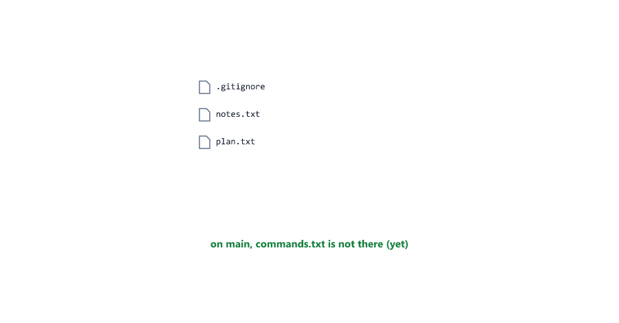
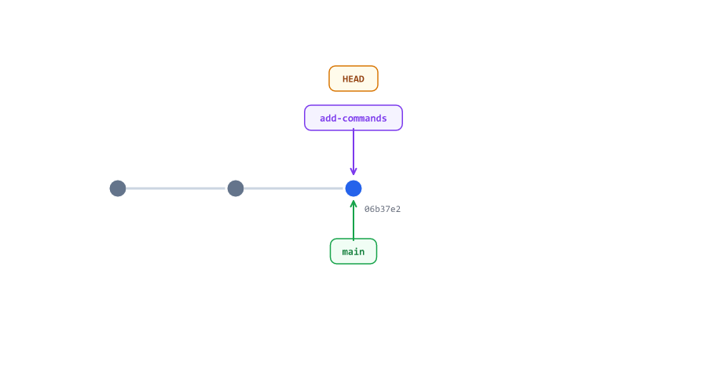
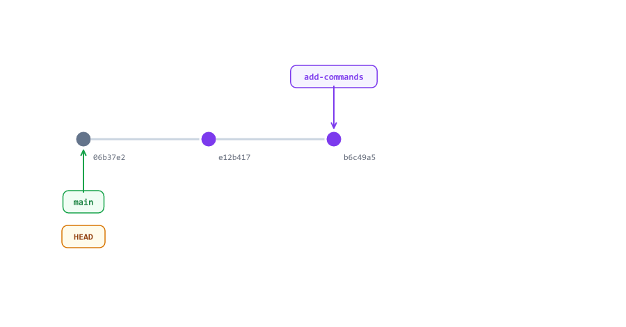

# Branches

> **Session 7 of 12** | Part 2: Branches | [All sessions](README.md#course-outline)

## Table of Contents
- [Why Branches?](#why-branches)
- [See Your Branches](#see-your-branches)
- [Create a Branch and Switch to It](#create-a-branch-and-switch-to-it)
- [Commit on the Branch](#commit-on-the-branch)
- [Switching Changes Your Files](#switching-changes-your-files)
- [Merge the Branch into main](#merge-the-branch-into-main)
- [Delete the Finished Branch](#delete-the-finished-branch)
- [When main Has Moved Too](#when-main-has-moved-too)
- [See Branches in the History](#see-branches-in-the-history)
- [Naming Branches](#naming-branches)
- [Beginner Mistakes](#beginner-mistakes)
- [Practice Exercises](#practice-exercises)
- [Interview Questions](#interview-questions)

---

## Why Branches?

So far, every commit went onto `main`. When you try something new there, you can break the version that works.

A **branch** is a separate line of commits. You try your idea on a branch, and `main` stays as it is. When the work is finished, you **merge** the branch into `main`. In a team, every new feature and every fix gets its own branch (Session 11).


---

## See Your Branches

Open `my-notes`

```bash
git branch
```

```text
* main
```

There is one branch, `main`. The `*` marks the branch you are on.

---

## Create a Branch and Switch to It

You will add a list of Git commands. Make a branch for it

```bash
git switch -c add-commands
```

```text
Switched to a new branch 'add-commands'
```

`-c` means **create**. Now there are two branches, and you are on the new one

```bash
git branch
```

```text
* add-commands
  main
```


A branch is only a **name for a commit**. A new branch starts at the commit you are on, which is why making one takes no time at all.

Older tutorials use `git checkout -b add-commands`. It does the same thing; `git switch` is the newer and clearer command.

---

## Commit on the Branch

Create `commands.txt`

commands.txt

```txt
git status - see what Git sees
git add - stage changes
git commit - save a snapshot
```

```bash
git add commands.txt
git commit -m "Add a list of git commands"
```

```text
[add-commands e12b417] Add a list of git commands
 1 file changed, 3 insertions(+)
 create mode 100644 commands.txt
```

The output starts with `[add-commands ...]`: the commit is on the branch.

```bash
git log --oneline -3
```

```text
e12b417 (HEAD -> add-commands) Add a list of git commands
06b37e2 (main) Revert "Change the notes title to this week"
200ad57 Add a note about git commit --amend
```

`add-commands` has one new commit. `main` (in brackets) is still at `06b37e2`.

---

## Switching Changes Your Files

Go back to `main`

```bash
git switch main
```

```text
Switched to branch 'main'
```

Look at the VS Code Explorer: `commands.txt` is gone. It is not deleted; it only exists on `add-commands`. `git ls-files` lists the files that Git tracks on the branch you are on

```bash
git ls-files
```

```text
.gitignore
notes.txt
plan.txt
```

Switch back, and the file is there again

```bash
git switch add-commands
```

```text
Switched to branch 'add-commands'
```

```bash
git ls-files
```

```text
.gitignore
commands.txt
notes.txt
plan.txt
```



Add one more line to `commands.txt`, `git log - show the history`, and commit it on the branch

```bash
git add commands.txt
git commit -m "Add git log to the commands"
```

```text
[add-commands b6c49a5] Add git log to the commands
 1 file changed, 1 insertion(+)
```



---

## Merge the Branch into main

The list is finished. To merge, go to the branch that **receives** the work, and merge the other branch into it

```bash
git switch main
```

```text
Switched to branch 'main'
```

```bash
git merge add-commands
```

```text
Updating 06b37e2..b6c49a5
Fast-forward
 commands.txt | 4 ++++
 1 file changed, 4 insertions(+)
 create mode 100644 commands.txt
```

**Fast-forward** means `main` had no new commits since the branch started, so Git only moved `main` forward to the branch's newest commit.

```bash
git log --oneline -4
```

```text
b6c49a5 (HEAD -> main, add-commands) Add git log to the commands
e12b417 Add a list of git commands
06b37e2 Revert "Change the notes title to this week"
200ad57 Add a note about git commit --amend
```



---

## Delete the Finished Branch

```bash
git branch -d add-commands
```

```text
Deleted branch add-commands (was b6c49a5).
```

The commits are not deleted, because they are on `main` now. Only the name `add-commands` is gone

```bash
git branch
```

```text
* main
```

---

## When main Has Moved Too

In a team, `main` usually gets new commits while you work on your branch. Start a branch for your learning goals

```bash
git switch -c add-goals
```

```text
Switched to a new branch 'add-goals'
```

goals.txt

```txt
- Use Git every day
- Make my first pull request
```

```bash
git add goals.txt
git commit -m "Add my learning goals"
```

```text
[add-goals b903523] Add my learning goals
 1 file changed, 2 insertions(+)
 create mode 100644 goals.txt
```

Meanwhile, something changes on `main`. Switch to it

```bash
git switch main
```

```text
Switched to branch 'main'
```

Add a line to `plan.txt`, `- Learn about merge conflicts`, and commit it

```bash
git add plan.txt
git commit -m "Add merge conflicts to the plan"
```

```text
[main 4c48957] Add merge conflicts to the plan
 1 file changed, 1 insertion(+)
```

Now both branches have a commit that the other one does not have

```bash
git log --oneline --graph --all -3
```

```text
* 4c48957 (HEAD -> main) Add merge conflicts to the plan
| * b903523 (add-goals) Add my learning goals
|/  
* b6c49a5 Add git log to the commands
```

`--graph` draws the branches with lines, and `--all` shows every branch, not only the one you are on. Merge

```bash
git merge --no-edit add-goals
```

```text
Merge made by the 'ort' strategy.
 goals.txt | 2 ++
 1 file changed, 2 insertions(+)
 create mode 100644 goals.txt
```

Git combined the changes of both branches in a new **merge commit**. Without `--no-edit`, Git opens VS Code with the message `Merge branch 'add-goals'` already written: save and close the tab.


---

## See Branches in the History

```bash
git log --oneline --graph -6
```

```text
*   35ceef5 (HEAD -> main) Merge branch 'add-goals'
|\  
| * b903523 (add-goals) Add my learning goals
* | 4c48957 Add merge conflicts to the plan
|/  
* b6c49a5 Add git log to the commands
* e12b417 Add a list of git commands
* 06b37e2 Revert "Change the notes title to this week"
```

Read it from the bottom up. The lines split after `b6c49a5`, each branch gets one commit, and the merge commit `35ceef5` joins them again. Delete the finished branch

```bash
git branch -d add-goals
```

```text
Deleted branch add-goals (was b903523).
```

These are the steps for every new piece of work


---

## Naming Branches

* Say what the work is: `add-commands`, `fix-cart-total`, `update-readme`
* Use small letters, and join words with `-`
* Never use spaces (Mistake 2)

Many teams also start the name with the kind of work, like `feature/login` or `fix/cart-total`.

---

## Beginner Mistakes

### Mistake 1: A typo in a branch name

```bash
git switch add-comands
```

```text
fatal: invalid reference: add-comands
```

Git does not know that name. Check the names with `git branch`.

---

### Mistake 2: A space in a branch name

```bash
git switch -c new feature
```

```text
fatal: invalid reference: feature
```

Git read `feature` as something else, and no branch was made. Use `new-feature`.

---

### Mistake 3: Deleting a branch that is not merged

A branch `try-idea` has a commit that is not on `main`

```bash
git branch -d try-idea
```

```text
error: the branch 'try-idea' is not fully merged
hint: If you are sure you want to delete it, run 'git branch -D try-idea'
hint: Disable this message with "git config set advice.forceDeleteBranch false"
```

Git protects work that exists only on that branch. If you really want to throw it away, use a capital `-D`

```bash
git branch -D try-idea
```

```text
Deleted branch try-idea (was 346e1bd).
```

---

### Mistake 4: Switching with changes that are not committed

A branch `edit-plan` has a commit that changed `plan.txt`. On `main`, you changed `plan.txt` too, without committing, and you switch

```bash
git switch edit-plan
```

```text
error: Your local changes to the following files would be overwritten by checkout:
	plan.txt
Please commit your changes or stash them before you switch branches.
Aborting
```

Switching would overwrite your changes, so Git stops. Commit them, or throw them away with `git restore`, then switch. Changes that do not clash are carried along to the other branch, which also surprises people. Commit before you switch.

---

### Mistake 5: Committing on the wrong branch

You forgot to make a branch and committed on `main`. Look at the first line of `git status` (`On branch ...`) before every commit. If it already happened and you have not pushed yet: `git reset --soft HEAD~1` (Session 06) keeps the changes staged, then `git switch -c <new-branch>` and commit there.

---

## Practice Exercises

### Exercise 1

Run `git switch -c add-shopping-list`, create a file with a few lines, and commit it. Check `git log --oneline`.

### Exercise 2

Switch between `main` and your branch a few times, and watch the file appear and disappear in VS Code.

### Exercise 3

Merge your branch into `main`. Was it a fast-forward? Then delete the branch.

### Exercise 4

Make a commit on a new branch and a different commit on `main`. Merge the branch, and look at `git log --oneline --graph`.

### Exercise 5

Make a branch with a commit, go back to `main`, and try `git branch -d` on it without merging. Read what Git says.

---

## Interview Questions

### What is a branch in Git?

A name that points to a commit. Every new commit on the branch moves the name forward, so the branch becomes a separate line of work.

### What is the difference between git switch and git switch -c?

`git switch <name>` goes to a branch that exists. `git switch -c <name>` creates a new branch and switches to it.

### What is a fast-forward merge?

When the branch that receives the work has no new commits, Git only moves it forward to the other branch's newest commit. No merge commit is made.

### What is a merge commit?

A commit with two parents. Git makes it when both branches have new commits, to join their histories.

### What happens to the commits when you delete a merged branch?

Nothing. They are part of `main` now; only the branch name is deleted.

---

| Previous | All sessions | Next |
| :--- | :---: | ---: |
| [06. Undoing Mistakes](06-undoing-mistakes.md) | [Course outline](README.md#course-outline) | [08. Merge Conflicts](08-merge-conflicts.md) |
