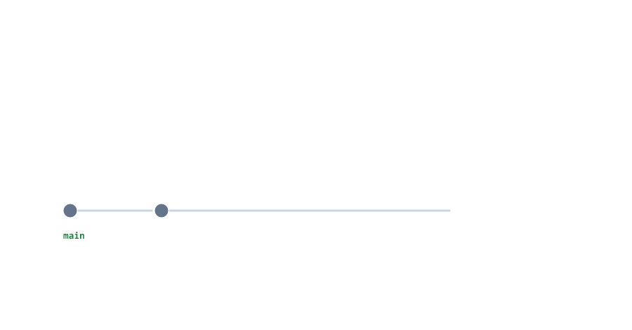

# Pull Requests

> **Session 11 of 12** | Part 3: GitHub | [All sessions](README.md#course-outline)

## Table of Contents
- [What a Pull Request Is](#what-a-pull-request-is)
- [The Workflow in Eight Steps](#the-workflow-in-eight-steps)
- [Step 1 to 3: Work on a Branch](#step-1-to-3-work-on-a-branch)
- [Step 4: Push the Branch](#step-4-push-the-branch)
- [Step 5: Open the Pull Request](#step-5-open-the-pull-request)
- [Step 6: Review and Change](#step-6-review-and-change)
- [Step 7: Merge on GitHub](#step-7-merge-on-github)
- [Step 8: Update Your Computer and Clean Up](#step-8-update-your-computer-and-clean-up)
- [Pull Requests in a Team](#pull-requests-in-a-team)
- [Beginner Mistakes](#beginner-mistakes)
- [Practice Exercises](#practice-exercises)
- [Interview Questions](#interview-questions)

---

## What a Pull Request Is

In Session 07 you merged branches yourself, on your computer. In a team, nobody merges into `main` alone. You push your branch to GitHub and open a **pull request** (PR): a request to merge your branch into `main`. Your teammates read the changes, comment, and when everything is right, the branch is merged on GitHub.



Pull requests are how almost every team works on GitHub, and also how people contribute to open-source projects. Even alone, they give you a clear record of every change.

---

## The Workflow in Eight Steps


Most steps happen on your computer, with commands you know. Three happen on the GitHub website.

---

## Step 1 to 3: Work on a Branch

Start from the newest `main` (Session 10)

```bash
git switch main
git pull
```

Make a branch for the work

```bash
git switch -c add-pr-notes
```

```text
Switched to a new branch 'add-pr-notes'
```

Create `pr-notes.txt`, and commit it

pr-notes.txt

```txt
A pull request asks to merge a branch into main
Teammates review it before it is merged
```

```bash
git add pr-notes.txt
git commit -m "Add notes about pull requests"
```

```text
[add-pr-notes 63308bc] Add notes about pull requests
 1 file changed, 2 insertions(+)
 create mode 100644 pr-notes.txt
```

---

## Step 4: Push the Branch

Push the branch to GitHub, with `-u` because it is new there (Session 09)

```bash
git push -u origin add-pr-notes
```

```text
remote: 
remote: Create a pull request for 'add-pr-notes' on GitHub by visiting:        
remote:      https://github.com/your-username/my-notes/pull/new/add-pr-notes        
remote: 
To https://github.com/your-username/my-notes.git
 * [new branch]      add-pr-notes -> add-pr-notes
branch 'add-pr-notes' set up to track 'origin/add-pr-notes'.
```

The lines that start with `remote:` come from GitHub. It gives you a link to open a pull request for this branch: **Ctrl+click** it in the VS Code terminal.


---

## Step 5: Open the Pull Request

Open your repository on GitHub. Right after a push, GitHub shows a yellow bar with a **Compare & pull request** button (the link from the terminal leads to the same page)

1. Check the two branches: **base: main** is where the work goes, **compare: add-pr-notes** is your branch
2. Write a short **title** that says what the pull request does: `Add notes about pull requests`
3. Write a **description**: what you changed and why, so a reviewer understands it without asking
4. Click **Create pull request**


GitHub gives the pull request a number. In this course's practice repository it is `#2`; your first pull request is `#1`.

If you installed the GitHub CLI (Session 09), you can also open it from the terminal, inside `my-notes`: `gh pr create --title "Add notes about pull requests" --body "A short file that explains what a pull request is."` It prints the link to the new pull request.

---

## Step 6: Review and Change

The pull request page has three tabs

| Tab              | What it shows                                                        |
| ---------------- | -------------------------------------------------------------------- |
| Conversation     | The description, the comments, and the merge button                  |
| Commits          | The commits of the branch                                            |
| Files changed    | The diff of all changes, like `git diff`. Reviewers comment on lines here |

A reviewer may ask for a change. You make it on the same branch, on your computer, and push again. Add a line to `pr-notes.txt`, `A pull request can get more commits after a review`

```bash
git add pr-notes.txt
git commit -m "Explain that a pull request can change after review"
```

```text
[add-pr-notes 9e283aa] Explain that a pull request can change after review
 1 file changed, 1 insertion(+)
```

```bash
git push
```

```text
To https://github.com/your-username/my-notes.git
   63308bc..9e283aa  add-pr-notes -> add-pr-notes
```

The pull request updates by itself: it now has two commits. There is no need to open a new one.

```bash
git status
```

```text
On branch add-pr-notes
Your branch is up to date with 'origin/add-pr-notes'.

nothing to commit, working tree clean
```

---

## Step 7: Merge on GitHub

When the review is done, open the pull request on GitHub

1. Click **Merge pull request**, then **Confirm merge**
2. GitHub says **Pull request successfully merged and closed**
3. Click **Delete branch**: the branch has done its job


The green button can also be switched to **Squash and merge** or **Rebase and merge**. This course uses the default, **Create a merge commit**: it works like `git merge` in Session 07.

---

## Step 8: Update Your Computer and Clean Up

The merge happened on GitHub. Your computer does not know about it yet

```bash
git switch main
```

```text
Switched to branch 'main'
Your branch is up to date with 'origin/main'.
```

"Up to date" is old news, because Git has not talked to GitHub since (Session 10). Pull

```bash
git pull
```

```text
From https://github.com/your-username/my-notes
   eb8738b..ea9432f  main       -> origin/main
Updating eb8738b..ea9432f
Fast-forward
 pr-notes.txt | 3 +++
 1 file changed, 3 insertions(+)
 create mode 100644 pr-notes.txt
```

```bash
git log --oneline --graph -4
```

```text
*   ea9432f (HEAD -> main, origin/main, origin/HEAD) Merge pull request #2 from your-username/add-pr-notes
|\  
| * 9e283aa (origin/add-pr-notes, add-pr-notes) Explain that a pull request can change after review
| * 63308bc Add notes about pull requests
|/  
* eb8738b Add a note about committing first
```

The merge commit `Merge pull request #2 from your-username/add-pr-notes` joins your branch into `main`. Your local branch is merged now, so delete it

```bash
git branch -d add-pr-notes
```

```text
Deleted branch add-pr-notes (was 9e283aa).
```

`git branch -a` shows **all** branches: yours, and the ones your computer remembers from GitHub

```bash
git branch -a
```

```text
* main
  remotes/origin/HEAD -> origin/main
  remotes/origin/add-pr-notes
  remotes/origin/main
```

`remotes/origin/add-pr-notes` is still there, although you deleted the branch on GitHub. `--prune` tells `git fetch` to forget remote branches that no longer exist

```bash
git fetch --prune
```

```text
From https://github.com/your-username/my-notes
 - [deleted]         (none)     -> origin/add-pr-notes
```

```bash
git branch -a
```

```text
* main
  remotes/origin/HEAD -> origin/main
  remotes/origin/main
```


Everything is clean, and you are ready for the next branch.

---

## Pull Requests in a Team

* **Reviewers:** on the pull request page, choose teammates under **Reviewers**. They approve it, or ask for changes. You cannot approve your own pull request
* **Protect main:** a repository owner can require a pull request for every change to `main` (**Settings > Branches**). Then nobody can push to `main` directly
* **Small pull requests:** a pull request with one small change is reviewed in minutes; one with fifty files waits for days
* **Projects you do not own:** click **Fork** on the project's GitHub page to get your own copy. Clone your fork, work on a branch, push it, and open a pull request to the original project. This is how open source works

---

## Beginner Mistakes

### Mistake 1: Doing the work on main

A pull request needs a branch with commits that `main` does not have. If you committed on `main` by mistake and have not pushed, move the work to a branch (Session 07, Mistake 5).

---

### Mistake 2: Forgetting to pull after the merge

Your `main` stays old, and your next branch starts from old code. After every merge on GitHub: `git switch main`, then `git pull`.

---

### Mistake 3: Opening a new pull request for every fix

Fixes after a review belong in the same pull request. Commit them on the same branch and `git push`.

---

### Mistake 4: Pushing unrelated work to an open pull request

Everything you push to the branch becomes part of the pull request. Start a new branch from `main` for a different task.

---

### Mistake 5: A pull request without a description

The reviewer has to guess what you changed and why. Write a short description, and keep pull requests small.

---

## Practice Exercises

### Exercise 1

Make a branch in `my-notes`, commit a new file, and push the branch with `git push -u origin <branch>`. Find the link in the output.

### Exercise 2

Open a pull request on GitHub with a title and a description. Look at the **Files changed** tab.

### Exercise 3

Make another commit on the same branch and push it. Check that the pull request now shows two commits.

### Exercise 4

Merge the pull request on GitHub and delete the branch there. Then run `git switch main`, `git pull` and `git log --oneline --graph`.

### Exercise 5

Delete your local branch with `git branch -d`. Run `git branch -a`, then `git fetch --prune`, then `git branch -a` again.

---

## Interview Questions

### What is a pull request?

A request on GitHub to merge one branch into another, usually into `main`. It shows the commits and the changes, so others can review them, comment and approve before the merge.

### Why do teams use pull requests instead of pushing to main?

Every change is reviewed before it reaches `main`, mistakes are found earlier, and there is a record of what changed and why.

### How do you update a pull request after a review?

Commit the changes on the same branch and push them. The pull request updates by itself.

### What should you do after a pull request is merged on GitHub?

Switch to `main` and pull, so your computer has the merge. Then delete the branch with `git branch -d` and clean up with `git fetch --prune`.

### What is a fork?

Your own copy of someone else's repository on GitHub. You push to your fork and open a pull request to the original repository.

---

| Previous | All sessions | Next |
| :--- | :---: | ---: |
| [10. Clone, Pull and Fetch](10-clone-pull-and-fetch.md) | [Course outline](README.md#course-outline) | [12. Final Project: Your Node.js Project on GitHub](12-final-project.md) |
