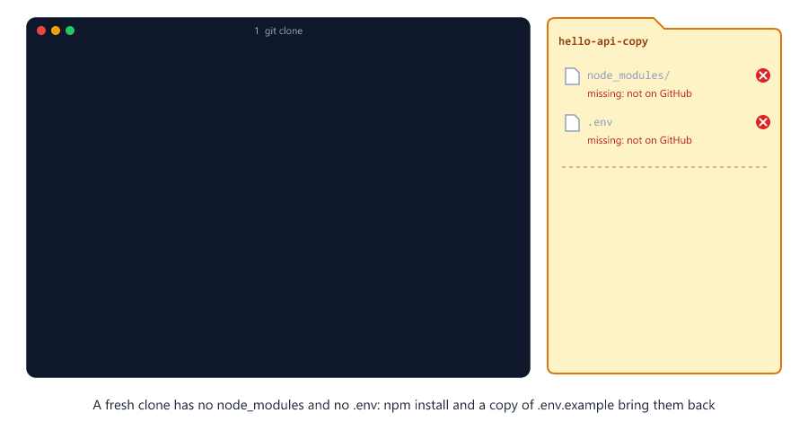

# Final Project: Your Node.js Project on GitHub

> **Session 12 of 12** | Part 4: Final Project | [All sessions](README.md#course-outline)

## Table of Contents
- [The Project](#the-project)
- [What You Need](#what-you-need)
- [Step 1: Create the Project](#step-1-create-the-project)
- [Step 2: Start Git and Add a .gitignore](#step-2-start-git-and-add-a-gitignore)
- [Step 3: Write a README](#step-3-write-a-readme)
- [Step 4: The First Commit](#step-4-the-first-commit)
- [Step 5: Put It on GitHub](#step-5-put-it-on-github)
- [Step 6: A New Route with a Pull Request](#step-6-a-new-route-with-a-pull-request)
- [Step 7: Clone It and Run It](#step-7-clone-it-and-run-it)
- [Your Checklist for Every New Project](#your-checklist-for-every-new-project)
- [What to Learn Next](#what-to-learn-next)
- [Beginner Mistakes](#beginner-mistakes)
- [Practice Exercises](#practice-exercises)
- [Interview Questions](#interview-questions)

---

## The Project

Time to use the whole course on a real project: a small Node.js API called `hello-api`. You build it, put it on GitHub with a `.gitignore` and a README, add a feature with a pull request, and then clone it into a new folder and run it, the way a teammate would.


This session is about Git. The project has one small code file, and you do not need to understand every line of it.

---

## What You Need

* **Node.js 22.9 or newer**: install the LTS version from [nodejs.org](https://nodejs.org/). It comes with **npm**, the tool that installs packages. This session was tested with Node.js 24
* Your GitHub account, and Git signed in to it (Session 09)

Check Node.js in a new terminal

```bash
node --version
```

It prints the version, like `v24.19.0`.

---

## Step 1: Create the Project

In `git-practice` (Session 03), create a folder `hello-api` and open it in VS Code (**File > Open Folder**). Every command until Step 7 runs in the VS Code terminal, inside `hello-api`.

`npm init -y` creates `package.json`, the file that describes a Node.js project

```bash
npm init -y
```

```text
Wrote to D:\git-practice\hello-api\package.json:

{
  "name": "hello-api",
  "version": "1.0.0",
  "description": "",
  "main": "index.js",
  "scripts": {
    "test": "echo \"Error: no test specified\" && exit 1"
  },
  "keywords": [],
  "author": "",
  "license": "ISC",
  "type": "commonjs"
}
```

Install Express, a small library for web servers

```bash
npm install express
```

```text

added 65 packages, and audited 66 packages in 1s

30 packages are looking for funding
  run `npm fund` for details

found 0 vulnerabilities
```

npm puts Express, and everything Express needs, into a new folder `node_modules`, and writes the exact versions into a new file `package-lock.json`. Your numbers may be different.

Open `package.json` and replace the `"test"` line under `"scripts"` with a `"start"` line. The file then looks like this (your Express version may be newer)

package.json

```json
{
  "name": "hello-api",
  "version": "1.0.0",
  "description": "",
  "main": "index.js",
  "scripts": {
    "start": "node --env-file-if-exists=.env index.js"
  },
  "keywords": [],
  "author": "",
  "license": "ISC",
  "type": "commonjs",
  "dependencies": {
    "express": "^5.3.0"
  }
}
```

`npm start` now runs `node --env-file-if-exists=.env index.js`: Node reads the settings in `.env`, if that file exists, and runs `index.js`.

Create `index.js`

index.js

```js
const express = require("express");

const app = express();
const PORT = process.env.PORT || 3000;

app.get("/", (req, res) => {
  res.send("Hello from my first API");
});

app.listen(PORT, (err) => {
  if (err) {
    console.log("Could not start server:", err.message);
    return;
  }
  console.log(`Server running on http://localhost:${PORT}`);
});
```

It starts a web server. `process.env.PORT` comes from `.env`; without it, the server uses port 3000. Create `.env`

.env

```txt
PORT=3000
```

`.env` holds the settings of this computer. In real projects it also holds passwords and secret keys, like `DB_PASSWORD=your-password-here` (Session 04), so it must **never** go to GitHub.

Start the server

```bash
npm start
```

```text

> hello-api@1.0.0 start
> node --env-file-if-exists=.env index.js

Server running on http://localhost:3000
```

Open http://localhost:3000 in your browser. It shows

```text
Hello from my first API
```

The server keeps running until you stop it: press **Ctrl+C** in the terminal.

---

## Step 2: Start Git and Add a .gitignore

```bash
git init
```

```text
Initialized empty Git repository in D:/git-practice/hello-api/.git/
```

```bash
git status
```

```text
On branch main

No commits yet

Untracked files:
  (use "git add <file>..." to include in what will be committed)
	.env
	index.js
	node_modules/
	package-lock.json
	package.json

nothing added to commit but untracked files present (use "git add" to track)
```

Stop here, and do not run `git add .` yet. Two of these must stay out of Git

| File or folder    | Why it stays out                                                                |
| ----------------- | ------------------------------------------------------------------------------- |
| `node_modules/`   | Thousands of files. `npm install` makes them again from `package.json` and `package-lock.json` |
| `.env`            | The settings of this computer, and later your passwords                         |

Create `.gitignore` (Session 04)

.gitignore

```txt
node_modules/
.env
*.log
```

Others who get your project still need to know which settings it uses. Create `.env.example`, with the same names as `.env` but **example values only**

.env.example

```txt
PORT=3000
```

```bash
git status
```

```text
On branch main

No commits yet

Untracked files:
  (use "git add <file>..." to include in what will be committed)
	.env.example
	.gitignore
	index.js
	package-lock.json
	package.json

nothing added to commit but untracked files present (use "git add" to track)
```

`node_modules/` and `.env` are gone from the list. `.gitignore` and `.env.example` are new.


---

## Step 3: Write a README

`README.md` is the first thing people see on your project's GitHub page. It says what the project is and how to run it. The `.md` means Markdown: `#` starts a heading, `-` a list item, and three backticks start and end a block of code.

README.md

````md
# hello-api

A small Express API: my first Node.js project on GitHub.

## Run it

```bash
npm install
npm start
```

Then open http://localhost:3000 in your browser.

## Routes

- `GET /` says hello
````

---

## Step 4: The First Commit

```bash
git add .
git status
```

```text
On branch main

No commits yet

Changes to be committed:
  (use "git rm --cached <file>..." to unstage)
	new file:   .env.example
	new file:   .gitignore
	new file:   README.md
	new file:   index.js
	new file:   package-lock.json
	new file:   package.json
```

Check this list before every first commit: six files, no `node_modules`, no `.env`.

```bash
git commit -m "First version of hello-api"
```

```text
[main (root-commit) 98daa5f] First version of hello-api
 6 files changed, 915 insertions(+)
 create mode 100644 .env.example
 create mode 100644 .gitignore
 create mode 100644 README.md
 create mode 100644 index.js
 create mode 100644 package-lock.json
 create mode 100644 package.json
```

Most of the 915 lines are in `package-lock.json`.

```bash
git log --oneline
```

```text
98daa5f (HEAD -> main) First version of hello-api
```

---

## Step 5: Put It on GitHub

The same steps as in Session 09

1. On GitHub, click **+**, then **New repository**
2. **Repository name**: `hello-api`. Choose **Public**: this is a project you can show
3. Do **not** add a README, a `.gitignore` or a license: your project already has its own
4. Click **Create repository**

Connect your project and push it

```bash
git remote add origin https://github.com/your-username/hello-api.git
git push -u origin main
```

Git prints a few progress lines first (Session 10), then

```text
To https://github.com/your-username/hello-api.git
 * [new branch]      main -> main
branch 'main' set up to track 'origin/main'.
```

Open `https://github.com/your-username/hello-api`. GitHub lists your six files, and shows your README under them as a formatted page.


---

## Step 6: A New Route with a Pull Request

New work goes on a branch (Session 07)

```bash
git switch -c add-time-route
```

```text
Switched to a new branch 'add-time-route'
```

In `index.js`, add a second route between the first route and `app.listen`

```js
app.get("/time", (req, res) => {
  res.json({ time: new Date().toISOString() });
});
```

And add a line at the end of `README.md`

```txt
- `GET /time` shows the time on the server
```

Try it: run `npm start` and open http://localhost:3000/time. The browser shows the current time, like this (the `Z` at the end means UTC time)

```text
{"time":"2026-11-01T06:47:32.333Z"}
```

Stop the server with **Ctrl+C**. Check your changes, and commit them

```bash
git diff
```

```text
diff --git a/README.md b/README.md
index 54da6e1..fe69d3c 100644
--- a/README.md
+++ b/README.md
@@ -14,3 +14,4 @@ Then open http://localhost:3000 in your browser.
 ## Routes
 
 - `GET /` says hello
+- `GET /time` shows the time on the server
diff --git a/index.js b/index.js
index d3457e8..7f65d48 100644
--- a/index.js
+++ b/index.js
@@ -7,6 +7,10 @@ app.get("/", (req, res) => {
   res.send("Hello from my first API");
 });
 
+app.get("/time", (req, res) => {
+  res.json({ time: new Date().toISOString() });
+});
+
 app.listen(PORT, (err) => {
   if (err) {
     console.log("Could not start server:", err.message);
```

```bash
git add .
git commit -m "Add a /time route"
```

```text
[add-time-route b59533b] Add a /time route
 2 files changed, 5 insertions(+)
```

Push the branch

```bash
git push -u origin add-time-route
```

```text
remote: 
remote: Create a pull request for 'add-time-route' on GitHub by visiting:        
remote:      https://github.com/your-username/hello-api/pull/new/add-time-route        
remote: 
To https://github.com/your-username/hello-api.git
 * [new branch]      add-time-route -> add-time-route
branch 'add-time-route' set up to track 'origin/add-time-route'.
```

Now the pull request on GitHub, like in Session 11

1. Click **Compare & pull request**
2. Title: `Add a /time route`. Description: `GET /time answers with the time on the server, as JSON.`
3. Click **Create pull request**. It is the first pull request in this repository, so it gets the number `#1`
4. Look at the **Files changed** tab. In a team, a teammate reviews it here. In your own project, you are the reviewer
5. Click **Merge pull request**, **Confirm merge**, and **Delete branch**

Back on your computer

```bash
git switch main
```

```text
Switched to branch 'main'
Your branch is up to date with 'origin/main'.
```

```bash
git pull
```

```text
From https://github.com/your-username/hello-api
   98daa5f..87a6e73  main       -> origin/main
Updating 98daa5f..87a6e73
Fast-forward
 README.md | 1 +
 index.js  | 4 ++++
 2 files changed, 5 insertions(+)
```

```bash
git log --oneline --graph -4
```

```text
*   87a6e73 (HEAD -> main, origin/main, origin/HEAD) Merge pull request #1 from your-username/add-time-route
|\  
| * b59533b (origin/add-time-route, add-time-route) Add a /time route
|/  
* 98daa5f First version of hello-api
```


`origin/add-time-route` is your computer's memory of the branch you deleted on GitHub. Clean up both, like in Session 11

```bash
git branch -d add-time-route
```

```text
Deleted branch add-time-route (was b59533b).
```

```bash
git fetch --prune
```

---

## Step 7: Clone It and Run It

The real test: does the project work for someone who only has GitHub, like a teammate, or you on a new computer? In the terminal, go up to `git-practice`, and clone the project into a new folder

```bash
cd ..
git clone https://github.com/your-username/hello-api.git hello-api-copy
```

```text
Cloning into 'hello-api-copy'...
```

```bash
cd hello-api-copy
git ls-files
```

```text
.env.example
.gitignore
README.md
index.js
package-lock.json
package.json
```

No `node_modules` and no `.env`: `.gitignore` kept them out of GitHub. `npm install` makes `node_modules` again, with the exact versions from `package-lock.json`

```bash
npm install
```

```text

added 65 packages, and audited 66 packages in 871ms

30 packages are looking for funding
  run `npm fund` for details

found 0 vulnerabilities
```

```bash
npm start
```

```text

> hello-api@1.0.0 start
> node --env-file-if-exists=.env index.js

.env not found. Continuing without it.
Server running on http://localhost:3000
```

It runs. Node tells you that `.env` is missing, so the server uses the default port. Stop it with **Ctrl+C**, and create `.env` from the example (`cp` works in PowerShell, Git Bash, macOS and Linux)

```bash
cp .env.example .env
```

In a real project, you now open `.env` and fill in your own values.


Git does not see the new file, because `.gitignore` came with the clone

```bash
git status
```

```text
On branch main
Your branch is up to date with 'origin/main'.

nothing to commit, working tree clean
```

```bash
npm start
```

```text

> hello-api@1.0.0 start
> node --env-file-if-exists=.env index.js

Server running on http://localhost:3000
```

Open http://localhost:3000 and http://localhost:3000/time: both routes work. Your project runs from GitHub alone.



---

## Your Checklist for Every New Project

1. `git init` in the new project folder
2. A `.gitignore` **before** the first `git add .`, with `node_modules/` and `.env`
3. A `.env.example` with example values, never real secrets
4. A `README.md` that says what the project is and how to run it
5. `git status` before every commit, and small commits with clear messages
6. An empty repository on GitHub, then `git remote add origin` and `git push -u origin main`
7. New work on a branch, merged with a pull request, then `git pull` on `main`
8. The test: a fresh clone, `npm install`, `npm start`


---

## What to Learn Next

You now know the Git that developers use every day. When you need more, these are the next topics

| Topic                 | What it does                                                   |
| --------------------- | -------------------------------------------------------------- |
| `git stash`           | Puts unfinished changes aside, so you can switch branches      |
| `git rebase`          | Another way to bring branches together, with a straight history |
| Tags and releases     | Mark a version of your project, like `v1.0.0`                  |
| SSH keys              | Another way to sign in to GitHub from Git                      |
| GitHub Actions        | Runs your tests on GitHub after every push                     |

Most of all, keep using Git. Put every project from the [JavaScript](https://github.com/mohin-sheikh/javascript-basics-to-advanced), [TypeScript](https://github.com/mohin-sheikh/typescript-basics-to-advanced) and [Node.js](https://github.com/mohin-sheikh/nodejs-learning-path) courses on GitHub, with a `.gitignore` and a README.

Congratulations: you finished the course.

---

## Beginner Mistakes

### Mistake 1: git add . before the .gitignore

`node_modules` and `.env` end up in the first commit. If you have not pushed yet, write the `.gitignore`, then stop tracking both with `git rm -r --cached node_modules .env` (`-r` because `node_modules` is a folder), and commit (Session 04). If `.env` was pushed, change every password in it: the old commit on GitHub still contains them.

---

### Mistake 2: Real secrets in .env.example

`.env.example` is committed, so it goes to GitHub. Write example values only, like `DB_PASSWORD=your-password-here`.

---

### Mistake 3: npm start before npm install

In a fresh clone, `node_modules` is missing. Node stops with a long error, and these are its important lines

```text
Error: Cannot find module 'express'
Require stack:
- D:\git-practice\hello-api-copy\index.js
```

Run `npm install` first. After every `git pull` that changes `package.json`, run it again.

---

### Mistake 4: Starting the server twice

A server from an earlier step still runs in another terminal, so port 3000 is taken

```bash
npm start
```

```text

> hello-api@1.0.0 start
> node --env-file-if-exists=.env index.js

Could not start server: listen EADDRINUSE: address already in use :::3000
```

Go to the other terminal and stop it with **Ctrl+C**, or use another port in `.env`, like `PORT=3001`.

---

### Mistake 5: A README with only the project name

People who open your repository do not know what it does or how to run it. Write both, and keep the README up to date: the `/time` route changed the README in the same commit.

---

## Practice Exercises

### Exercise 1

Build `hello-api` yourself, step by step, and push it to GitHub.

### Exercise 2

On a new branch, add a route `GET /about` that sends one sentence about you, and add it to the README. Merge it with a pull request, then pull `main`.

### Exercise 3

Clone your repository into a new folder. Check with `git ls-files` that `node_modules` and `.env` are not there, then run `npm install` and `npm start`, and open both routes.

### Exercise 4

On your repository page on GitHub, click the gear icon next to **About**, and add a description and topics like `nodejs` and `express`.

### Exercise 5

Put one of your own projects on GitHub, for example one from the JavaScript or Node.js course, with a `.gitignore`, a `.env.example` if it uses secrets, and a README.

---

## Interview Questions

### Why is node_modules not committed?

It is large, and `npm install` makes it again from `package.json` and `package-lock.json`. It stays out through `.gitignore`.

### Why commit package-lock.json?

It records the exact version of every package, so everyone who runs `npm install` gets the same versions.

### What is the difference between .env and .env.example?

`.env` holds the real settings and secrets of one computer, and Git ignores it. `.env.example` has the same names with example values. It is committed, and shows others which settings to fill in.

### What should a README contain?

What the project does, how to install and run it, and how to use it. For an API, its routes.

### How do you put a new project on GitHub?

`git init`, a `.gitignore`, a first commit, an empty repository on GitHub, then `git remote add origin <url>` and `git push -u origin main`.

---

| Previous | All sessions | Next |
| :--- | :---: | ---: |
| [11. Pull Requests](11-pull-requests.md) | [Course outline](README.md#course-outline) | [Node.js Learning Path](https://github.com/mohin-sheikh/nodejs-learning-path) |
